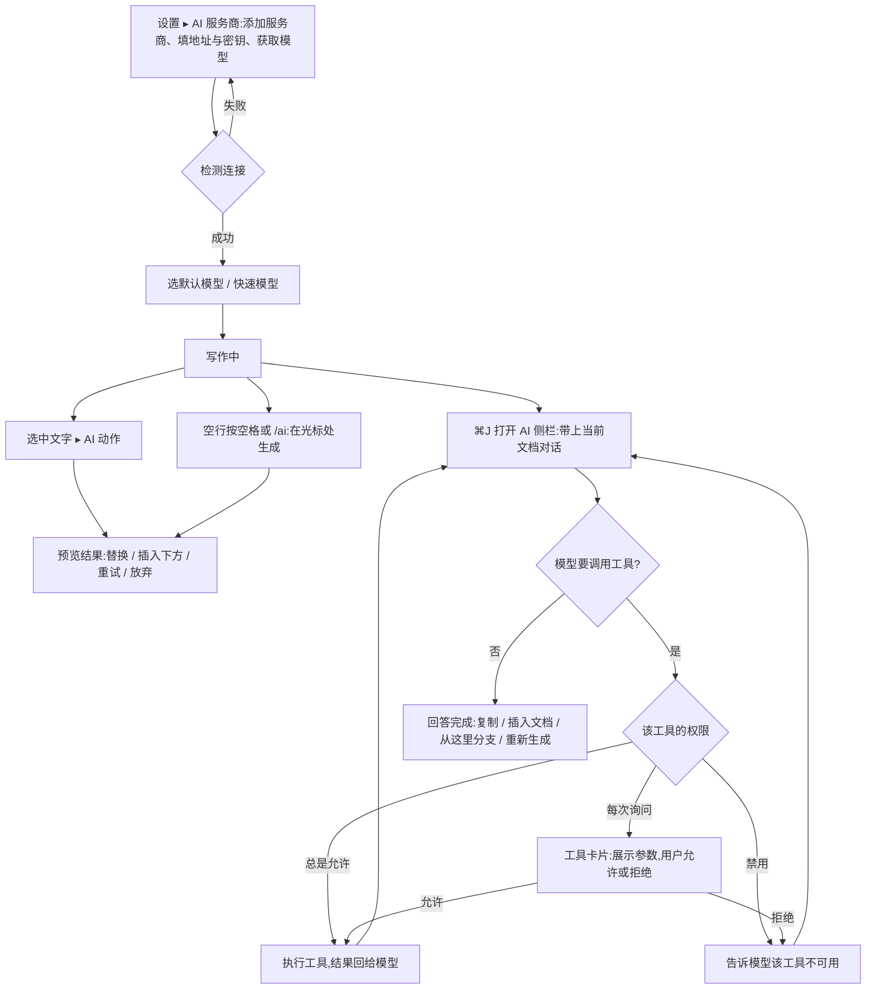

# Typoza AI 版

> 版本 v0.1 · 2026-10-16 · 产品
>
> AI 版 = 基础版全部功能(见 `typoza-prd.md`)+ 本文的 AI 能力。基础版文档与对照表照常适用,本文只写新增部分。
>
> 信息来源:调研报告(Cherry Studio v2.1.6、CC Switch v4.0.13、CLIProxyAPI、Agent Skills 开放规范 agentskills.io、MCP 规范 2026-07-28,各条来源链接见研发调研记录);用户要求「AI 参照 Cherry Studio / CC Switch / CPA,有分支、连接器、Skills、MCP」。
> 「CPA」按 CLIProxyAPI 理解【待确认】;「连接器」按 Claude 的用法理解为建在 MCP 之上、开箱即用的连接【待确认】。

## 一、需求概述

在 Typoza 里写作的人,想不离开编辑器就让 AI 改写、续写、总结、翻译当前文档,和 AI 讨论时能把文档当上下文,讨论结果能直接放回文档;同时希望自己选服务商与模型(含本机模型、自建代理),能接入 MCP 工具与 Skills。AI 版在基础版之上增加:服务商与模型管理、AI 侧栏对话(含分支)、选中文字的 AI 动作、斜杠 `/ai`、MCP 服务器与连接器、工具调用确认、Skills、助手预设。

本期不做:Cherry 的知识库向量检索、多模型同屏对比、带脚本的 Skills 执行、MCP Apps 界面、联网搜索、用量与费用统计、手机端;AI 不参与云同步(对话与配置只存本机)。涉及本机用户、用户自选的 AI 服务商、用户配置的 MCP 服务器。

### 质量要求

| 指标 | 目标 | 口径 |
|---|---|---|
| 流式显示 | 收到模型的每段输出后 50 毫秒内上屏 | 不含网络与模型本身耗时 |
| 编辑不卡 | 生成过程中在正文输入,p95 ≤16 毫秒 | 与基础版输入延迟同口径 |
| 密钥不落盘 | 服务商密钥、MCP 凭据只在 macOS 钥匙串 | 扫描应用数据目录与偏好设置文件,不出现明文密钥 |
| 不越权 | 未经用户确认,工具调用不执行写入、删除、本机命令 | 默认「每次询问」;日志可查 |
| 纯本地可用 | 不配置任何服务商时,AI 入口提示去设置,其余功能与基础版一致 | 不发起任何 AI 网络请求 |

## 二、业务流程与状态

**消息状态**

| 状态 | 进入条件 | 用户可做 |
|---|---|---|
| 生成中 | 发送后开始流式输出 | 停止 |
| 等待确认 | 模型请求调用「每次询问」的工具 | 允许 / 拒绝(拒绝后模型继续回答) |
| 已完成 | 模型结束本轮输出 | 复制、插入文档、从这里分支、重新生成、编辑后重发 |
| 已停止 | 用户点停止 | 保留已输出部分;可重新生成 |
| 出错 | 网络、鉴权、限流、模型报错 | 显示服务商返回的原因与【重试】;401 / 403 提示检查密钥 |

## 三、功能需求

### 3.1 服务商与模型

| 功能 | 规则 | 边界与异常 |
|---|---|---|
| 服务商列表 | 设置 ▸「AI 服务商」:添加、改名、启用 / 停用、删除(确认);预设 OpenAI、Anthropic、Google Gemini、DeepSeek、OpenRouter、本机 Ollama、本机 LM Studio、自定义 | 删除服务商时,用它的助手与对话改用默认模型并提示 |
| 接口协议 | 每个服务商选一种:Anthropic Messages、OpenAI Chat Completions、OpenAI Responses、Gemini;自定义地址可接 CC Switch、CLIProxyAPI 等本机路由(调研:三者都落在这四种协议上) | 地址末尾写 `#` 表示原样使用、不自动拼接口路径(与 Cherry Studio 一致) |
| 密钥 | 存 macOS 钥匙串;设置页只显示打码后的末 4 位;可填多个(逗号分隔),请求失败为 401 / 429 时轮换下一个【假设】 | 本机服务商可不填密钥 |
| 获取模型 | 【获取模型列表】调服务商的模型列表接口;也可手动添加模型 ID;每个模型可标「支持工具调用」「支持看图」 | 服务商没有列表接口时提示手动添加 |
| 检测连接 | 用所选模型发一条极短请求,显示成功或服务商返回的错误原文 | 超时 20 秒【假设】 |
| 默认模型 | 「默认模型」用于对话与 AI 动作;「快速模型」用于起对话标题、生成摘要这类轻任务;没设快速模型时用默认模型 | 未配置任何可用模型时,AI 入口提示「请先在设置 ▸ AI 服务商中添加模型」并给【去设置】 |
| 请求参数 | 温度、Top P、最大输出长度,可在助手里覆盖;请求超时 120 秒【假设】 | 服务商不支持的参数不发送 |

### 3.2 AI 侧栏对话

| 功能 | 规则 | 边界与异常 |
|---|---|---|
| 打开 | ⌘J(Notion「Ask AI」)或菜单「AI ▸ 打开对话」;侧栏在编辑区右侧,可拖宽度、可关闭 | ⌘J 原是 Typora「跳到所选内容」,AI 版改为 ⌥⌘J【假设】(冲突时 Notion 优先) |
| 上下文 | 默认带上当前文档全文;有选区时只带选区;输入框上方显示上下文标签,可移除;超出模型上下文时截断并提示「文档过长,只带了前 N 字」 | 未保存的新文档也可作为上下文 |
| `@` 引用 | 输入 `@` 选择:文件夹里的其他文档、之前的对话、MCP 资源 | 引用的文档读不到时提示并跳过 |
| `/` 命令 | 输入 `/` 列出:助手的快捷指令、MCP 提示词(分组显示) | — |
| 流式输出 | 逐段上屏,Markdown 实时渲染(代码块、公式、表格);【停止】随时中断 | 网络中断时保留已输出内容,状态为「出错」 |
| 回答操作 | 复制(Markdown)、插入到光标处、替换选区、插入到文末 | 文档只读时「插入」置灰 |
| 对话列表 | 侧栏顶部切换历史对话;自动用快速模型起标题,可改名、删除(确认)、导出为 Markdown | 对话存本机 `~/Library/Application Support/Typoza/ai/`,不进云同步 |

### 3.3 对话分支与多版本

| 功能 | 规则 | 边界与异常 |
|---|---|---|
| 从这里分支 | 任意一条消息的菜单「从这里分支」:新分支带上到这条为止的上下文,原分支不变(与 Cherry Studio 一致) | — |
| 编辑后重发 | 改自己发过的一条消息再发,形成新分支 | — |
| 重新生成 | 对回答点【重新生成】得到新版本;消息下方 ‹ 2/3 › 切换版本,后续对话跟着所选版本走 | — |
| 分支切换 | 对话顶栏的分支下拉:列出各分支(以分叉处消息开头命名),切换后显示该分支的完整路线 | 分支画布(树状图)本期不做 |
| 导出分支 | 「导出当前分支为 Markdown」「插入当前分支到文档」 | — |

### 3.4 选中文字的 AI 动作

| 功能 | 规则 | 边界与异常 |
|---|---|---|
| 入口 | 选中文字后浮动格式条上的【AI】,或右键「AI ▸」 | 代码块里选中时只给「解释」「改写」 |
| 内置动作 | 改写、润色、缩短、扩写、改正错别字与语法、翻译(目标语言可选)、解释、总结、续写 | — |
| 自定义动作 | 设置 ▸「AI 动作」:名称 + 提示词(可用 `{{selection}}` `{{document}}` 占位)+ 模型;可排序 | 提示词为空不能保存 |
| 结果预览 | 结果流式显示在选区下方的浮层,不直接改文档;【替换】【插入下方】【重试】【放弃】;Esc 放弃 | 生成中改动了选区内容时,【替换】改为提示「原文已改动,请重新生成或插入下方」 |
| 撤销 | 替换或插入是一次编辑,⌘Z 一步撤回 | — |

### 3.5 在光标处生成(`/ai`、空行按空格)

| 功能 | 规则 | 边界与异常 |
|---|---|---|
| 入口 | 斜杠菜单「AI 写作」(`/ai`);空行开头按空格(Notion)弹出 AI 输入框 | 空行按空格可在设置里关闭;关闭后空格照常输入 |
| 生成 | 输入指令回车,结果以待确认块显示在光标处(浅色底);【接受】【重试】【放弃】 | 未接受前保存文档,待确认块不写入文件 |
| 上下文 | 带上全文,并标明光标位置 | — |

### 3.6 MCP 服务器与连接器

| 功能 | 规则 | 边界与异常 |
|---|---|---|
| 添加 | 设置 ▸「MCP 服务器」:stdio(命令、参数、环境变量)或 Streamable HTTP(地址、请求头);可粘贴 `mcpServers` 格式的 JSON 一次导入多个 | 旧的 HTTP+SSE 传输标为「已废弃」,能连则连,不推荐(规范 2026-07-28) |
| 环境变量与请求头 | 值里的密钥存钥匙串,配置文件只存引用 | — |
| 状态 | 每个服务器显示:已连接 / 连接中 / 失败(原因)/ 已停用;展开看工具、提示词、资源列表与最近日志 | 启动失败显示 stderr 末尾 20 行 |
| 工具开关 | 逐个工具「总是允许 / 每次询问 / 禁用」;新工具默认「每次询问」 | — |
| 授权 | HTTP 服务器要求 OAuth 时,在系统浏览器里完成登录,令牌存钥匙串 | 不在应用内网页里登录(规范要求客户端看不到登录页内容) |
| 征询 | 服务器请求用户补充信息时,弹原生表单;要打开网址的交给系统浏览器 | 用户取消即回复「已拒绝」 |
| 连接器 | 开箱即用的内置连接,打开开关即可用:「当前文件夹」(列出、搜索、读取文件夹里的文档;写入需确认)、「网页读取」(把网址正文转为 Markdown,默认关) | 内置连接器与外部 MCP 服务器在工具列表里分组显示【假设】 |

### 3.7 工具调用确认

| 功能 | 规则 | 边界与异常 |
|---|---|---|
| 工具卡片 | 对话里显示:工具名、来源(哪个服务器)、参数(可展开 JSON)、状态;「每次询问」的工具显示【允许】【总是允许此工具】【拒绝】 | 参数里的长文本折叠显示 |
| 结果 | 显示工具返回内容(过长时折叠);出错时显示错误 | 单次结果超过 20000 字时截断后再交给模型并提示【假设】 |
| 改文档 | 模型通过「修改当前文档」工具改正文时,先以差异预览展示(删除标红、新增标绿,光标与滚动定位到第一处改动;【应用】【拒绝】浮在编辑区底部),确认后才写入,一次确认 = 一步撤销 | 用户在确认前改了正文,预览失效并提示;大文档载入完才预览 |
| 轮次上限 | 一次回答里连续调用工具最多 20 轮【假设】,到上限停下并提示 | — |

### 3.8 Skills

| 功能 | 规则 | 边界与异常 |
|---|---|---|
| 来源 | 设置 ▸「技能」:从文件夹或 ZIP 安装到 `~/Library/Application Support/Typoza/skills/`;也可读取 `~/.agents/skills/`(开关,默认关) | — |
| 格式 | 符合 Agent Skills 规范:每个技能一个目录,`SKILL.md` 带 name 与 description;name 不合规时提示原因并不加载 | — |
| 加载方式 | 对话开始时只把各技能的名字与描述交给模型;模型需要时再读取正文与资源(渐进加载) | — |
| 启用 | 全局开关 + 每个助手单独选用哪些技能;对话里显示本轮用到了哪个技能 | — |
| 脚本 | 带 `scripts/` 的技能本期只读说明、不执行脚本,安装时提示「此技能包含脚本,Typoza 不会执行」 | — |

### 3.9 助手

| 功能 | 规则 | 边界与异常 |
|---|---|---|
| 助手预设 | 名称、图标、系统提示词、模型、温度等参数、启用的技能与 MCP 服务器;内置「写作助手」「翻译」「代码解释」三个【假设】 | — |
| 切换 | 侧栏顶部选择助手;新对话用所选助手 | 删除助手时其对话保留,改用默认助手 |

## 四、安全与隐私

- 密钥(服务商、MCP 环境变量与请求头、OAuth 令牌)只存 macOS 钥匙串,不写进文档、偏好设置、对话记录、日志;导出配置时去掉密钥。
- 发给模型的内容只有用户明确带上的:当前文档或选区、`@` 引用的文档、工具返回结果;侧栏上方始终显示本次会发出的上下文。
- MCP 工具默认「每次询问」;stdio 服务器以本机子进程运行,添加时提示「将以你的权限在本机运行此命令」。
- 对话记录只存本机,不进云同步;可在设置里一键清除全部对话。
- 网络请求只发往用户配置的地址;未配置服务商时不发任何 AI 请求。

## 五、验收口径

全部在 CI 上用模拟服务跑通(不连真实模型):

1. 基础版用例全部通过。
2. 四种协议的模拟服务商:配置、获取模型、检测连接、流式输出、停止、出错与重试。
3. 切换默认模型 / 助手后请求发往正确的服务商与模型。
4. 分支:从中间消息分支、编辑后重发、重新生成多版本切换,各分支上下文正确。
5. MCP:用测试服务器(stdio 与 Streamable HTTP 各一)完成工具列表、每次询问的允许 / 拒绝、总是允许、禁用;提示词出现在 `/`,资源出现在 `@`。
6. Skills:安装合规与不合规技能;模型按需读取正文。
7. 选中文字改写:预览、替换、插入、⌘Z 撤回;`/ai` 生成后接受 / 放弃。
8. 扫描应用数据目录与偏好设置文件,不出现测试密钥明文。

## 变更记录

| 日期 | 变更 | 原因 |
|---|---|---|
| 2026-10-16 | 初稿 | 基础版功能补齐后开始 AI 版 |
