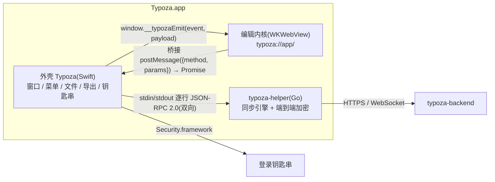

# Typoza 客户端技术方案(基础版)

> 需求以 `docs/prd/` 为准,同步协议以 `typoza-backend/docs/sync-protocol.md` 为准。本文讲客户端怎么实现、为什么这样实现、边界在哪。

## 1. 一句话

macOS 原生外壳(Swift / AppKit)+ WKWebView 里的编辑内核(TypeScript / ProseMirror)+ 按需启动的同步辅助进程(Go)。
纯本地即可完整使用:没用过云同步时不启动辅助进程、不发任何同步请求。

## 2. 进程与模块



| 部分 | 目录 | 职责 | 不做什么 |
|---|---|---|---|
| 外壳 | `app/Sources/Typoza` | 窗口与标签、Typora 结构的中文菜单、文件读写(原子写、编码识别)、FSEvents 监听、本地历史、导出(PDF / HTML / 图片 / Pandoc)、打印、辅助进程生命周期、钥匙串 | 不解析 Markdown、不含业务界面 |
| 外壳工具库 | `app/Sources/TypozaKit` | 可单测的纯逻辑:编码、文件服务、搜索、历史、链接预览、`typoza://` 协议处理、桥接参数、桥接来源校验、辅助进程 JSON-RPC 连接、钥匙串 | — |
| 编辑内核 | `editor/src` | Markdown ↔ 文档模型、所见即所得编辑、Notion 输入与快捷键、灯箱与媒体、侧栏、偏好、云同步界面 | 不直接碰文件系统,一律经 Host 接口 |
| 辅助进程 | `helper/` | 账号、库关联、同步引擎(上传 / 下载 / 冲突 / 回收站 / 历史)、把事件推给外壳 | 不碰界面;密钥不落自己的磁盘 |
| 同步核心 | `helper/third_party/typoza-sdk` | 后端仓库 `sdk/` 的副本(后端仓库私有,CI 拉不到),`scripts/vendor-sdk.sh` 拷贝,`SOURCE` 记来源提交 | 本仓库不改它,改动回后端仓库再拷 |

为什么这样分:编辑体验要 ProseMirror 生态(插件、输入规则、节点视图),外壳要原生菜单、文件权限与钥匙串;同步核心与服务端同一种语言、同一份协议实现,服务端 e2e 测试直接复用。

## 3. 编辑内核

### 3.1 Markdown 管线

```
文本 ─ unified/remark-parse + remark-gfm + remark-math + remark-frontmatter + 自研 micromark 扩展(==高亮== ^上标^ ~下标~)
     ─ transform.ts:mdast 后处理,生成自定义节点(提示块、折叠块、媒体、目录、维基链接、HTML 标记配对、<br>)
     ─ parse.ts:mdast → ProseMirror 文档;同时记下每个顶层块的原文切片(BlockSource)
编辑
     ─ serialize.ts:没改过的顶层块原样写回原文(连同块间空行);改过的块 → mdast → mdast-util-to-markdown(自定义处理器)
```

- **不改语义、尽量不改字节**:原文切片挂在 `WeakMap<PMNode, BlockSource>` 上,节点对象不变就写回原文。所以打开 → 保存逐字节不变(CI 单测做语义往返:CommonMark 规范 652 例(#173 跳过,原因见 `tests/unit/markdown.test.ts`)、GFM 扩展章节与脚注示例 26 例、Typora 语料;冒烟测试做字节往返)。
- **新内容优先标准 Markdown**:提示块存 GitHub `> [!TIP]`,折叠块存 `<details>`,颜色存 `<span style>`,书签存 `<a data-tz-type="bookmark">`,表情存 Unicode 字符。
- **Typora 兼容**:`typora-root-url`、`typora-copy-images-to`、``、`[TOC]`、`:smile:` 短码(装饰显示、原文保留)、编辑器根节点 `id="write"`(Typora 主题选择器)。
- **序列化细节**:段落 / 标题末尾空格直接去掉(Markdown 本就忽略,避免写出 `&#x20;`);相邻同类列表换用不同标记符避免被合并。

### 3.2 编辑器组成

`core/editor.ts` 组装插件,顺序有讲究:弹出菜单的按键处理(斜杠、表情 / 提及)排在快捷键前面,输入规则排在自动配对前面。

| 模块 | 内容 |
|---|---|
| `core/schema.ts` | 块:标题、列表(项内 `block+`)、提示块、折叠块(含折叠标题)、代码、公式、表格、媒体、目录、脚注、HTML;行内:图片、公式、维基链接、HTML;标记:链接、粗斜体、代码、删除线、下划线、高亮、上下标、颜色 |
| `core/inputrules.ts` `core/keymap.ts` | Notion 块级 / 行内快捷输入与快捷键(冲突时 Notion 优先),Typora 额外快捷键并存 |
| `plugins/` | 斜杠菜单、`:` 表情与 `@` 提及、粘贴(Markdown / 网址菜单 / 文件导入)、选区工具条、块手柄与拖动、查找替换、表格、专注 / 打字机、`:smile:` 短码显示 |
| `views/` | CodeMirror 代码块、KaTeX 公式、Mermaid 图(严格安全级别)、图片(双击灯箱、缩放手柄)、视频音频与在线嵌入(iframe 沙箱)、书签卡片、PDF、附件 |
| `ui/lightbox.ts` | 灯箱:FLIP 打开动画、以光标为中心缩放(10%–800%)、拖动、双击适配 ↔ 100%、←/→ 切换本文全部图片、旋转、复制 |

### 3.3 按需加载

主包约 1 MB(含 ProseMirror、CodeMirror、remark)。Mermaid(及其布局引擎)、KaTeX、表情数据(约 240 KB,构建期从 emojibase 裁剪生成 `virtual:tz-emoji`)、二维码库都在首次用到时才加载,不影响冷启动。

### 3.4 大文档

- **代码块懒建编辑器**:每个代码块先用静态 `<pre>` 占位,接近视口(上下各约一屏)、获得光标或被点击时才建 CodeMirror。上千个 CodeMirror 实例的创建、测量与销毁曾是打开和关闭大文档的主要耗时。
- **换文档重建编辑器视图**:打开另一篇文档时销毁旧的 EditorView、新建一个,不在旧视图上 `updateState`。新旧文档差异很大时,`updateState` 会在已挂载的 DOM 上逐个拆旧节点,WebKit 里 5MB 文档要 20 秒以上;销毁视图是整块摘下 DOM,实测切回小文档约 0.65 秒。
- **依赖补丁**:`scripts/patch-deps.mjs` 在 npm 安装时改 `micromark-extension-gfm-table` 的 EditMap,不再复制未改动的事件前缀;补丁未落盘时安装直接失败,单测再校验一次。
- **性能剖析**:独立工作流 `.github/workflows/perf.yml`,推 `perf` 分支触发(不被 dev 的推送取消)。Chromium 用 CDP 采样剖析解析、打开、输入、切回四个阶段,WebKit 只计时,看耗时随文档大小的增长;结果在 `ci/perf` 分支的 `perf/perf.md`。macOS 冒烟另在真实应用里量 5MB 文档的解析、打开、输入 p95 与保存。

## 4. 宿主桥接

- 契约:`editor/src/host/types.ts` 的 `Host` 接口;方法名即桥接消息的 `method`(`fs.readText`、`dialog.open`…),外壳 `DocumentWindowController.handle` 按名分发。浏览器开发与 E2E 用内存宿主 `host/memory.ts`(含模拟云同步 `host/fake-sync.ts`,方法与错误码对齐辅助进程)。
- 资源:编辑器从 `typoza://app/` 加载(ES module 在 `file://` 下不可靠);本机文件走 `typoza://local/<绝对路径>`,支持 HTTP Range(视频拖动进度)。
- **来源校验**:WKWebView 的消息处理器对所有框架可见,文档里嵌入的网页也能调用;外壳只接受主框架且来源为 `typoza://app` 的调用(`BridgeOrigin`)。HTML 块经 DOMPurify 净化(去掉 script / style / object / embed / form,预览去掉 class / id),iframe 加沙箱:只有远程网页给同源,本地网页与相对地址不给。PDF 框不加沙箱(要用系统的 PDF 显示),只按路径判断 `.pdf`(`x.html#.pdf` 不算)。
- **本机文件隔离**:`typoza://local` 下所有文件同源,带着它跑脚本就能读走本机任意文件。外壳对其中的网页类文件(html / xhtml / svg / xml)加 `Content-Security-Policy: sandbox` 响应头(不透明源),所有本机文件 `nosniff`;资源地址只认 http(s) / data / blob / file / typoza。编辑器页面自身有 CSP,只执行应用自带脚本;文档里的 HTML 片段一律在 `<template>` 或 DOMParser 里解析(游离 div 里的 `` 会执行)。
- 导航:主框架只允许 `typoza://`;点到本机 Markdown 在 Typoza 打开,其余网址交给系统浏览器。

## 5. 云同步客户端

### 5.1 链路

```
网页 host.syncCall('sync.login', …)
  → 桥接 sync.call → 外壳 HelperManager.callFromWeb(只放行 sync.*)
  → 辅助进程 JSON-RPC → syncsvc → sdk(account / engine)→ 服务端
结果统一包成 {ok, result} / {ok:false, error:{code, message}},网页据错误码分支(如 totp_required 显示验证码框)
```

辅助进程推来的通知:`sync.status`(整体状态)、`sync.event`(进度、已同步、冲突、错误)由外壳转发给所有窗口;`session.secrets` 只给外壳。辅助进程需要外壳做的事(把远端已删除的文件移进废纸篓)走反向请求 `host.trash`。

### 5.2 密钥与数据

| 数据 | 存哪 | 说明 |
|---|---|---|
| 刷新令牌、访问令牌、账户密钥(32 字节)、服务器、用户与设备 ID | 登录钥匙串,`app.typoza.mac.sync` / `session`,仅本机、解锁后可读 | 辅助进程启动后外壳经 `session.resume` 交回;令牌轮换、登录、退出、登录失效时辅助进程推 `session.secrets`,外壳串行写入 / 删除 |
| 服务器、邮箱、库与本机文件夹的对应 | `~/Library/Application Support/Typoza/sync/config.json`(0600) | 不含密钥;退出登录后保留,用于预填与同账号重新登录后接着同步;换账号时清掉旧关联 |
| 每个库的同步状态(bbolt)与合并基线 | `…/sync/vaults/<库 ID>/` | 解除关联时删除;本机文件与云端数据都不动 |
| 辅助进程日志 | `~/Library/Logs/Typoza/helper.log` | 超过 5 MB 清空;不记录密钥 |

主密码只在注册、登录、改密、恢复时经内存传给辅助进程,用于派生密钥,任何地方都不保存。

### 5.3 生命周期

- 应用启动时有 `config.json` 才在后台启动辅助进程并恢复会话;否则等用户打开「云同步」设置页。
- 意外退出:按退避(1 秒起、每次加倍、最多 1 分钟)重启并重新恢复会话。
- 退出应用:关闭管道,辅助进程停引擎后自行退出,最多等 3 秒。
- 任一请求发现登录已失效(他机改密、被移除):辅助进程停止全部引擎、推空密钥,状态带原因,网页提示重新登录。

### 5.4 界面

偏好「云同步」页:登录 / 注册 / 恢复码重置;同步文件夹(添加、立即同步、云端回收站、停止同步);修改主密码、两步验证(二维码)、登录设备。
状态栏同步摘要(失败时带【重试】)、文件树同步标记(已同步 / 待上传 / 同步中 / 同步失败)、历史面板「本机 / 云端」两栏、冲突提示与并排对比(保留云端 / 保留我的 / 都保留)、窗口回到前台时拉取更新(最短间隔 30 秒)。

## 6. 构建、测试与发布(全部在 GitHub Actions 上)

| CI 任务 | 内容 | 产物 |
|---|---|---|
| editor(Ubuntu,Node 24) | 构建、类型检查、Vitest 单测(含 CommonMark 规范用例)、Playwright WebKit E2E、渲染应用图标 | `editor-dist`、`app-icon` |
| helper(Ubuntu,Go) | vet、`go test -race`(含两台设备经 RPC 的端到端流程,对着 sdk 假服务端)、交叉编译 darwin arm64 / amd64 | `helper-darwin` |
| macos(macOS 15) | `swift test`、组装通用二进制 Typoza.app(内嵌辅助进程、图标、ad-hoc 签名)、冒烟自检、打 DMG | `Typoza.dmg` |
| perf(Ubuntu,独立工作流) | 推 `perf` 分支触发:大文档分阶段剖析(Chromium 采样 + WebKit 计时) | `perf/perf.md` |

- 每个任务把步骤日志与产物强推到 `ci/<任务名>` 孤儿分支,本机 `git fetch origin '+refs/heads/ci/*:refs/remotes/origin/ci/*'` 后用 `git show origin/ci/<任务名>:<文件>` 查看(仓库私有、无 API 令牌)。
- 冒烟自检:以 `--smoke-out` 启动打包好的应用,写入截图场景文档 → 打开 → 双击表格里的图片 → 确认灯箱与图片加载 → 字节往返 → 经外壳调辅助进程取同步状态 → 截图并写 `smoke.json`。

## 7. 已知限制

- 未用 Apple 开发者证书签名与公证:首次打开需右键 → 打开;每次更新后钥匙串会询问一次是否允许访问。
- 文件树「同步中 / 待上传」按事件与修改时间推断,同步进行中被再次修改的文件可能短暂显示为已同步,下一轮同步后纠正。
- 辅助进程按库各开一条 WebSocket;macOS 上文件监听走 kqueue,每个目录占一个文件描述符(Go 运行时已把软上限提到硬上限)。
